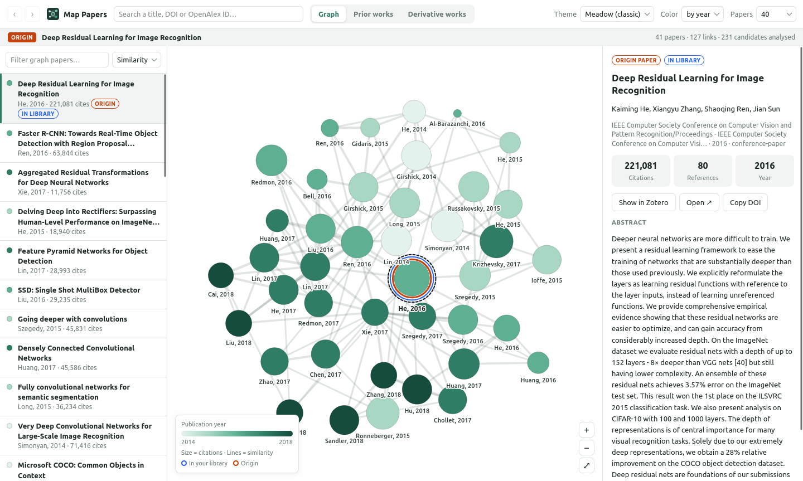

# Map Papers for Zotero

A similarity-graph explorer for Zotero 7–10, in the style of [connectedpapers.com](https://www.connectedpapers.com/).
Select a paper and open a similarity graph of related work, plus lists of **prior works**
(the foundations) and **derivative works** (what came after).



## Install

1. Build (or grab) `build/map-papers.xpi`.
2. In Zotero: **Tools → Plugins → ⚙ → Install Plugin From File…** and pick the `.xpi`.

## Use

- **Item pane:** select an item. The *Map Papers* section has **Graph**,
  **Prior works** and **Derivative works** buttons.
- **Right-click an item → Map Papers →** Show graph / Prior works / Derivative works.
- **Tools → Map Papers…** opens the window with a search box (title, DOI or OpenAlex ID).

In the window:

| | |
|---|---|
| **Graph** | Papers are placed by similarity, not by direct citation. Node size = citations, color = year (or relation to the origin), line thickness = similarity. Blue ring = already in your library. Drag to pan, scroll to zoom, drag nodes, hover to highlight neighbours, press **F** to fit. |
| **Prior works** | *Common to the graph:* older works that many graph papers cite. *This paper's references:* everything the origin cites. Sort by relevance, citations, year or title. |
| **Derivative works** | *Citing the graph:* works from the origin's year on that cite at least two graph papers. *Citing this paper:* everything that cites the origin. **Sort by citations** (default) or year. Both come from OpenAlex already sorted, so you get the true top works and not just the top of a sample. Relevance and title sort locally. Click column headers to sort. *Load more* pages further. |
| **Details panel** | Abstract, metrics, **Add to Zotero** (via DOI lookup, into the selected library/collection), Show in Zotero, Open, **Build graph** from this paper, Copy DOI. |
| **Toolbar** | Back/forward history, **Theme**, color mode, number of papers (20–80). |

Themes: Meadow (classic), Midnight, Dracula, Viridis, Sunset, Ocean, Monochrome, Solarized dark.
Your choice is remembered, and you can also set it in **Settings → Map Papers**.

## How it works

Data comes from [OpenAlex](https://openalex.org) (free, no account). For an origin paper the
plugin collects its references, its most-cited and newest citing papers, OpenAlex's related
works, and works its neighbourhood cites often (~230 candidates). It then scores every pair by

- **bibliographic coupling**: they cite the same works, and
- **co-citation**: they're cited by the same works,

keeps the ~40 papers most similar to the origin and its neighbourhood, and lays them out with
stress majorization, so similar papers sit close together. A graph costs about 8 requests.
Without a key OpenAlex allows about 1,000 a day. For more, add a free API key in
Settings → Map Papers.

Items are matched by DOI, then arXiv ID (URL/Extra), then title. An `OpenAlex: W…` line in
*Extra* forces a specific work.

## Development

Requires Node ≥ 22 and Zotero installed (auto-detected, or set `ZOTERO_BIN`). No npm dependencies.

```bash
npm run build        # syntax check + build/map-papers.xpi
npm test             # core algorithm tests (offline)
npm run test:live    # also builds a real graph from OpenAlex
npm run dev          # Zotero with a throwaway profile, plugin loaded from addon/
npm run dev -- --debug-server   # ...plus remote control for:
npm run smoke        # end-to-end test in the running dev Zotero, screenshots → build/screenshots/
```

`npm run dev` never touches your real profile or library (`.dev/`). Restart it to reload code.

```
addon/
  bootstrap.js            plugin lifecycle
  prefs.js                default prefs
  content/lib/core.js     OpenAlex client, similarity, layout, prior/derivative works (Zotero-free)
  content/lib/themes.js   color themes
  content/scripts/main.js Zotero integration: item pane, menus, item lookup, add to library
  content/graph/          the graph window (HTML/CSS/canvas)
  content/preferences.xhtml
scripts/                  build, dev launcher, tests, DevTools-protocol client
```
